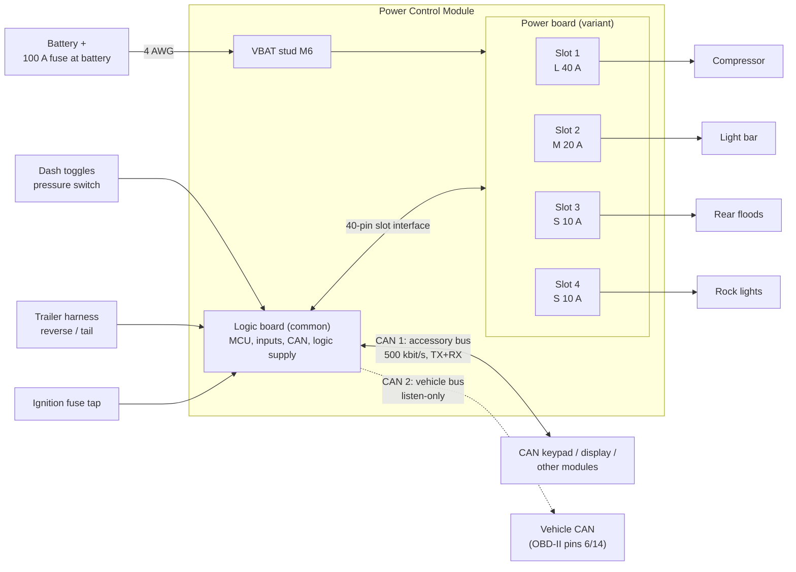
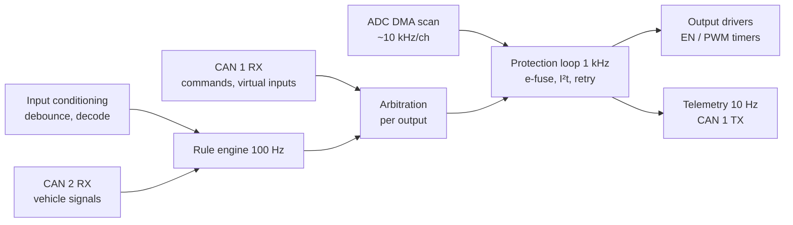

# 02 — Architecture

## System context

Load returns go to chassis ground near each load; they do **not** come back
through the module. The module ground stud carries only logic current and
the L-channel freewheel current, which keeps the ground stud and its wire
small and avoids a high-current ground path through the board.

## Modularity — three levels

The request was for a modular unit with "different flavors" of channel. The
design is modular at three levels, each solving a different problem:

| Level | What varies | Mechanism |
|---|---|---|
| **Channel** | Current class of each output | Each output slot is built from one of three *channel cells* (S/M/L). A cell is a reusable KiCad hierarchical sheet + layout block that implements the common [slot interface](#slot-interface). |
| **Board** | Mix of cells | Power board *variants* combine cells (e.g. `LMSS`, `MMMM`, `LLSS`). The logic board is the same for every variant; a per-slot ID resistor and a calibration EEPROM tell firmware what is fitted. |
| **System** | Number of outputs | Up to 4 modules share one CAN bus (2-bit address strap). A JK with 16 outputs is four modules, not a bigger board. |

### Why a two-board stack instead of one board

| Option | For | Against |
|---|---|---|
| Single board, populate options | Cheapest, one assembly | Every variant is a re-layout of the whole board; logic and power copper weights conflict (heavy copper makes fine-pitch MCU routing harder and dearer). |
| **Logic + power stack (chosen)** | Logic board is designed and validated once; power board is heavy copper with a simple layout; the power board bolts flat to the enclosure floor for heat sinking. | Board-to-board connector is a vibration item (mitigated with locking header + standoffs); two fab orders. |
| Plug-in card per channel | Field-swappable channels | 40 A through a card edge or board-to-board connector is the weakest point in the system; four extra connectors per unit. Revisit only if field swapping becomes a requirement. |

### Power board variants

Naming is the slot classes in order. Only the default is laid out for rev A.

| Variant | Slots | Continuous total | Use |
|---|---|---|---|
| **`LMSS`** (default) | 40 + 20 + 10 + 10 | 80 A | Compressor, light bar, two light groups |
| `MMMM` | 4 × 20 | 80 A | Lighting-only build |
| `MMSS` | 20 + 20 + 10 + 10 | 60 A | Lighting with a smaller feed (6 AWG) |
| `SSSS` | 4 × 10 | 40 A | Rock lights, coils, accessories; second module on the bus |
| `LLSS` | 40 + 40 + 10 + 10 | 100 A | Exceeds EL-8; needs a larger stud and feed. Not planned. |

Total current is limited by the battery stud, feed cable and board copper
(EL-8), not by the sum of the slots. Firmware enforces a module-level
current budget as well as per-channel limits.

## Slot interface

Every channel cell, whatever its class, presents the same signals to the
logic board. This contract is what makes the cells interchangeable.

| Signal | Dir (from logic board) | Type | Notes |
|---|---|---|---|
| `CHn_EN` | out | 3.3 V logic, PWM capable | Pulled down on the power board: output OFF if the logic board is absent or the MCU is in reset. |
| `CHn_ISENSE` | in | analog 0–3.0 V | Scaled per class so 1.5 × rating ≈ 2.5 V; > 2.9 V means fault. |
| `CHn_FAULT_N` | in | open drain | Hardware trip latched (L) or PROFET fault (S/M via IS level, also routed here by a comparator). |
| `CHn_DIAG` | out | 3.3 V logic | PROFET `DEN`; L-cell fault-clear / low-Iq control. |
| `CHn_TEMP` | in | analog | NTC near the switch (L cell); S/M cells fit a resistor that reads "not fitted". |
| `CHn_ID` | in | analog | Resistor to ground with a pull-up on the logic board: S = 10 k, M = 22 k, L = 47 k, empty = open. |

Shared pins: `VBAT_SENSE` (gated divider), `+5V`, `+3V3`, `GND` (4 pins),
`I2C_SCL`, `I2C_SDA` (calibration EEPROM on the power board), `OUT_SENSEn`
(output voltage dividers, used for open-load and short-to-battery detection).

4 channels × 6 + 12 shared = 36 signals → **2 × 20, 2.0 mm pitch** board-to-board
header (4 spare pins), with two M3 standoffs carrying the mechanical load.

## Data flow inside the MCU

Arbitration order per output, highest first:

1. **Protection** — a tripped or latched channel stays off whatever is asking.
2. **Load shed** — battery-voltage and module-budget rules.
3. **Local override** — an input configured as an override for this output.
4. **CAN command** — while the host's command is fresh (see
   [06-can-protocol.md](06-can-protocol.md#timeouts-and-failsafe)).
5. **Rules** — the autonomous configuration.
6. **Default** — OFF.

See [07-firmware.md](07-firmware.md) for the loops and state machines.
