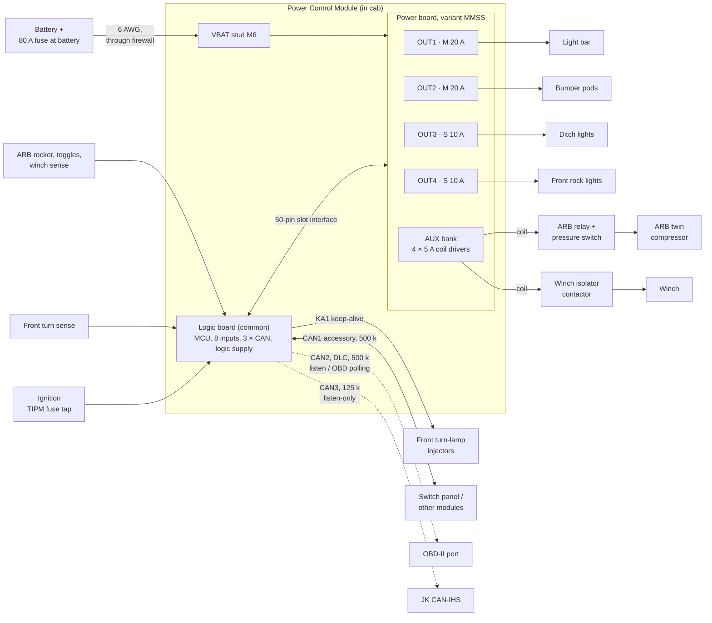
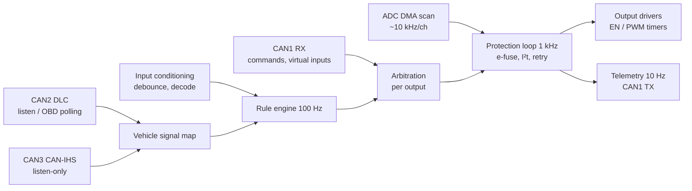

# 02 — Architecture

## System context (JK front module)

The JK uses two modules — this one in the glovebox and a rear module in the
cargo area; the two-module layout is in [13](13-multi-module-system.md).

Load returns go to chassis ground near each load; they do **not** come back
through the module. The module ground stud carries only logic current, AUX
coil current and, on builds with an L cell, its freewheel current, which
keeps the ground stud and its wire small and avoids a high-current ground
path through the board.

The ARB twin and the winch carry their own motor current through their own
relay and contactor; the module switches only their coils
([12](12-compressor-and-winch.md)).

## Modularity — three levels

The request was for a modular unit with "different flavors" of channel. The
design is modular at three levels, each solving a different problem:

| Level | What varies | Mechanism |
|---|---|---|
| **Channel** | Current class of each main output | Each output slot is built from one of three *channel cells* (S/M/L). A cell is a reusable KiCad hierarchical sheet + layout block that implements the common [slot interface](#slot-interface). |
| **Board** | Mix of cells | Power board *variants* combine cells (e.g. `MMSS`, `LMSS`, `SSSS`). The logic board and the AUX bank are the same in every variant; a per-slot ID resistor and a calibration EEPROM tell firmware what is fitted. |
| **System** | Number of outputs | Up to 4 modules share one CAN bus (2-bit address strap) and read each other's values as peers. The JK uses two (glovebox `MMSS` + rear `SSSS`, [13](13-multi-module-system.md)); 16 outputs would be four modules, not a bigger board. |

### Why a two-board stack instead of one board

| Option | For | Against |
|---|---|---|
| Single board, populate options | Cheapest, one assembly | Every variant is a re-layout of the whole board; logic and power copper weights conflict (heavy copper makes fine-pitch MCU routing harder and dearer). |
| **Logic + power stack (chosen)** | Logic board is designed and validated once; power board is heavy copper with a simple layout; the power board bolts flat to the aluminium base plate for heat sinking. | Board-to-board connector is a vibration item (mitigated with locking header + standoffs); two fab orders. |
| Plug-in card per channel | Field-swappable channels | 40 A through a card edge or board-to-board connector is the weakest point in the system; four extra connectors per unit. Revisit only if field swapping becomes a requirement. |

### Power board variants

Naming is the slot classes in order. Every variant also carries the AUX bank.

| Variant | Slots | Continuous total | Use |
|---|---|---|---|
| **`MMSS`** (JK default, laid out for rev A) | 20 + 20 + 10 + 10 | 60 A | JK front module: light bar, pods, ditch lights, front rock lights; compressor and winch on AUX |
| `LMSS` | 40 + 20 + 10 + 10 | 80 A | A single-motor compressor powered directly from the L slot |
| `MMMM` | 4 × 20 | 80 A | Heavier lighting |
| `SSSS` | 4 × 10 | 40 A | JK rear module: halogen rear floods, RIGID Chase courtesy, rear rock and camp lights, with the Chase on AUX; rock-light zones, accessories |
| `LLSS` | 40 + 40 + 10 + 10 | 100 A | Exceeds EL-8; needs a larger stud and feed. Not planned. |

Total current is limited by the battery stud, feed cable and board copper
(EL-8), not by the sum of the slots. Firmware enforces a module-level
current budget as well as per-channel limits.

The L cell stays in the cell library: the ARB twin draws more than it is
rated for and keeps its own relay, but a single-motor compressor, a fridge
and inverter feed, or another vehicle can use it.

## Slot interface

Every channel cell, whatever its class, presents the same signals to the
logic board. This contract is what makes the cells interchangeable.

| Signal | Dir (from logic board) | Type | Notes |
|---|---|---|---|
| `CHn_EN` | out | 3.3 V logic, PWM capable | Pulled down on the power board: output OFF if the logic board is absent or the MCU is in reset. |
| `CHn_ISENSE` | in | analog 0–3.0 V | Scaled per class so 1.5 × rating ≈ 2.5 V; > 2.9 V means fault. |
| `CHn_FAULT_N` | in | open drain | Hardware trip latched (L) or PROFET fault (S/M via IS level, also routed here by a comparator). |
| `CHn_DIAG` | out | 3.3 V logic | PROFET `DEN`; L-cell fault-clear / low-Iq control. |
| `CHn_TEMP` | in | analog | NTC near the switch (L cell); S/M cells fit a resistor that reads "not fitted". |
| `CHn_ID` | in | analog | Resistor to ground with a pull-up on the logic board: S = 10 k, M = 22 k, L = 47 k, empty = open. |

AUX bank (two dual-channel PROFET+2 devices, fixed in every variant):

| Signal | Dir | Notes |
|---|---|---|
| `AUX1_IN` … `AUX4_IN` | out | On/off; pulled down on the power board |
| `AUX_DEN` | out | Diagnosis enable, shared by both devices |
| `AUX_DSEL` | out | Selects which channel of each dual device drives its sense pin |
| `AUX_IS_A`, `AUX_IS_B` | in | Current sense, one per dual device, multiplexed by `AUX_DSEL` |

Header pin budget:

| Group | Pins |
|---|---:|
| 4 slots × 6 | 24 |
| `OUT_SENSE1–4` (output voltage dividers: open-load, short-to-battery) | 4 |
| AUX bank | 8 |
| `VBAT_LOGIC` × 2 (logic supply feed, PTC-protected on the power board) | 2 |
| `+5V`, `+3V3` | 2 |
| `GND` | 6 |
| `VBAT_SENSE` (gated divider) | 1 |
| `I2C_SCL`, `I2C_SDA` (power-board EEPROM) | 2 |
| Spare | 1 |
| **Total** | **50** |

→ **2 × 25, 2.0 mm pitch** board-to-board header, with two M3 standoffs
carrying the mechanical load. (The first revision listed a 2 × 20 header and
omitted the logic-supply feed pins; corrected here.)

## Data flow inside the MCU

Arbitration order per output (main and AUX), highest first:

1. **Protection** — a tripped or latched channel stays off whatever is asking.
2. **Load shed** — battery-voltage and module-budget rules.
3. **Local override** — an input configured as an override for this output.
4. **CAN command** — while the host's command is fresh (see
   [06-can-protocol.md](06-can-protocol.md#timeouts-and-failsafe)).
5. **Rules** — the autonomous configuration.
6. **Default** — OFF.

The winch override switch sits outside this list on purpose: it powers the
contactor coil directly, so it works even when the module does not
([12](12-compressor-and-winch.md#wiring-recommended-option)).

See [07-firmware.md](07-firmware.md) for the loops and state machines.
