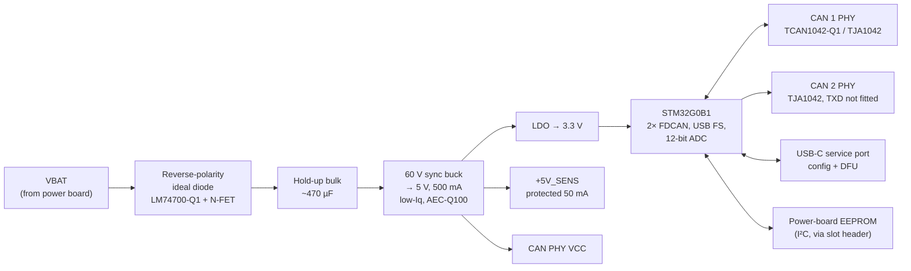

# 05 — Logic board: supply, MCU, CAN

The logic board is common to every power-board variant. It carries no load
current.

## Block diagram

## Logic supply

| Stage | Choice | Why |
|---|---|---|
| Reverse protection | LM74700-Q1 ideal-diode controller + small N-FET | ~20 mV drop instead of a Schottky's 0.4 V, which matters at 6 V cranking; blocks the bulk capacitor from back-feeding the battery line during dips, which gives hold-up. |
| Input clamp | Module-level TVS on the power board (SM8S24A-class, 24 V stand-off) | 24 V stand-off passes a 24 V jump start (EL-4) and clamps suppressed load dump. Everything on VBAT is rated ≥ 40 V. |
| Hold-up | ~470 µF aluminium-polymer after the ideal diode | Rides through ~28 ms of 0 V at 100 mA input current (`C·ΔV/I` = 470 µF × 6 V / 0.1 A, 11 → 5 V). Fit 1000 µF if testing shows resets on short interruptions. |
| Buck | 60 V synchronous buck, ≤ 30 µA no-load Iq, AEC-Q100 (TI LMR3600x-Q1 class) | 60 V input covers unsuppressed transients behind the TVS; a linear regulator from 14 V would burn ~1 W in a sealed box. |
| 3.3 V | Low-Iq LDO from 5 V | Clean ADC reference supply; MCU plus logic < 60 mA. |
| ADC reference | 3.0 V precision reference on `VREF+` | Current-sense accuracy should not track the 3.3 V rail. |

The 5 V rail feeds the CAN transceivers (5 V `VCC`, 3.3 V `VIO`) and the
`+5V_SENS` sensor supply.

## MCU

**STM32G0B1** (Cortex-M0+, 64 MHz, up to 512 KB flash, -40…125 °C grade
available). Chosen for:

- 2 × FDCAN — one per bus, with hardware filters and bus-monitoring
  (listen-only) mode,
- USB FS device without a crystal, and a ROM DFU bootloader (confirm USB
  DFU support for the chosen package in ST AN2606),
- 12-bit ADC with enough channels for 4 × ISENSE, 4 × inputs, IGN, VBAT,
  4 × OUT_SENSE, 4 × ID, NTCs (multiplexed where needed),
- timers for 4 independent PWM outputs and the 1 kHz protection tick,
- a mature, inexpensive toolchain (STM32Cube, or Rust/Embassy).

Alternative if more headroom is needed: STM32G474 (Cortex-M4F, 3 × FDCAN).
Pin budget is the main risk on the G0B1 — use the 64-pin package.

Other logic-board parts:

| Part | Purpose |
|---|---|
| 2-bit address strap (solder jumpers + DIP alternative) | Module address 0–3 (FN-11) |
| Board NTC + MCU internal sensor | Board temperature for derating |
| Tag-Connect TC2030 footprint | SWD programming/debug |
| USB-C (inside enclosure, under a sealed cap) | Configuration and firmware update |
| One status LED through a light pipe | Heartbeat / fault blink code |
| IWDG + window watchdog | Firmware hang → reset → outputs off (FN-14) |

## CAN

### CAN 1 — accessory bus (transmit + receive)

- ISO 11898-2 high-speed, **500 kbit/s** classic CAN by default (250 kbit/s
  and 1 Mbit/s configurable; CAN FD capable hardware, not used by default
  for compatibility with keypads and displays).
- Transceiver with standby + remote wake (TCAN1042-Q1 or TJA1042), ±58 V
  bus-fault protection class, so a CAN wire chafed onto battery survives
  (EL-9).
- Split termination 2 × 60 Ω + 4.7 nF, enabled by solder jumper (or a
  configuration-controlled analog switch on a later rev). Only the two
  physical ends of the bus terminate.
- Common-mode choke footprint (fit if EMC testing needs it) and a CAN ESD
  diode array at the connector.
- CAN-H/CAN-L appear twice on the signal connector so modules daisy-chain
  without a splice.

### CAN 2 — vehicle bus (listen-only, enforced in hardware)

The module may read vehicle data (speed, gear, headlight/high-beam state,
engine running) but **must never transmit** on the vehicle bus — a bad frame
or even an ACK at the wrong bitrate can disturb safety-relevant ECUs.

Three independent barriers:

1. **Hardware:** the transceiver's `TXD` is tied recessive (high) through a
   resistor and the MCU-to-`TXD` 0 Ω link is **not fitted**. The module
   physically cannot drive the bus — not even ACK bits.
2. **Peripheral:** FDCAN2 runs in bus-monitoring mode.
3. **Firmware:** no TX mailbox is ever configured on FDCAN2.

Because the module does not ACK, it must never be the only other node on a
bus — not an issue on a vehicle bus, but bench testing needs a second node.

### Jeep JK vehicle bus — what is known

Confidence: moderate. Verify on the target vehicle with a CAN sniffer
before relying on any of this.

- The JK (2007–2018) exposes **CAN-C** (high-speed powertrain/chassis bus,
  500 kbit/s) at the OBD-II connector, pins 6 (CAN-H) and 14 (CAN-L).
- The interior bus differs by model year (a low-speed fault-tolerant CAN-B
  on early years, a high-speed interior bus on later years). It is not
  needed for this module's purposes.
- Signal IDs are not published by the manufacturer. Firmware therefore
  **hard-codes no vehicle IDs**: vehicle signals are mapped by configuration
  (`can_id`, start bit, length, byte order, scale, offset, timeout), filled
  in after sniffing the actual vehicle. See
  [07-firmware.md](07-firmware.md#vehicle-signal-map).
- Newer vehicles (e.g. JL) put a security gateway in front of the OBD port;
  broadcast traffic there may be limited. Tapping a bus behind the gateway
  is a vehicle-specific decision and out of scope for rev A.

Connection: a short OBD-II pass-through harness (pins 4/5 ground, 6/14 CAN)
so the diagnostic port remains usable.

## Sleep and wake

| State | Entered when | Current | Exits on |
|---|---|---|---|
| **Run** | Any wake source | 40–80 mA (logic) | — |
| **Idle-awake** | IGN off, all outputs off, timers running (e.g. courtesy timer) | 30–50 mA | Timers expire → Sleep |
| **Sleep** | IGN off, outputs off, no CAN 1 traffic for 30 s, no pending timers | ≈ 145 µA estimated | IGN high; CAN 1 activity (transceiver remote wake); input change found by the 100 ms scan; RTC alarm |

A rule may keep an output on with ignition off (e.g. rock lights at camp).
Low-voltage load shed protects the battery in that case: default shed below
12.0 V for 60 s with IGN off, configurable per output.

Sleep budget detail (`python3 tools/budget.py`):

| Item | Qty | µA each | µA total |
|---|---:|---:|---:|
| Buck regulator, no-load Iq | 1 | 25 | 25 |
| 5 V → 3.3 V LDO Iq | 1 | 15 | 15 |
| MCU in STOP with RTC + EXTI | 1 | 10 | 10 |
| CAN transceiver in standby | 2 | 15 | 30 |
| PROFET+2 channel off-state | 3 | 1 | 3 |
| L-channel gate driver, low-Iq mode | 1 | 20 | 20 |
| Pulsed input scan, switch open | 4 | 4 | 16 |
| MCU wake-ups for the scan | 1 | 20 | 20 |
| VBAT sense divider, gated off | 1 | 1 | 1 |
| Reverse-polarity / TVS leakage | 1 | 5 | 5 |
| **Total** | | | **145** |

Requirement EL-7 is ≤ 250 µA, leaving margin for datasheet-vs-real Iq.
Measured value replaces this table in test SL-1.
