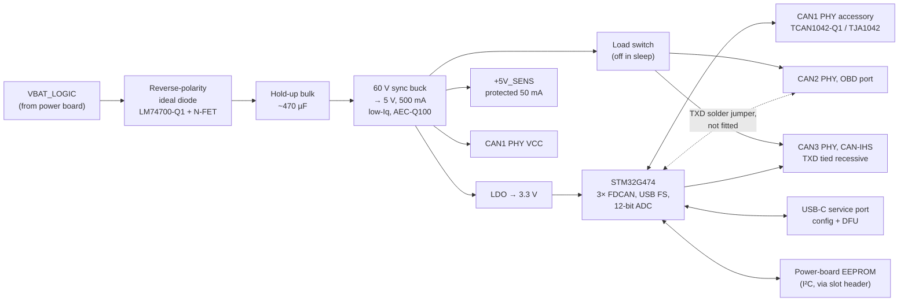

# 05 — Logic board: supply, MCU, CAN

The logic board is common to every power-board variant. The only load
current it carries is the lamp keep-alive rail (≤ 1 A at 5–8 V,
[14](14-lamp-keep-alive-and-bluetooth.md#keep-alive-hardware-on-the-logic-board)).

## Block diagram

## Logic supply

| Stage | Choice | Why |
|---|---|---|
| Reverse protection | LM74700-Q1 ideal-diode controller + small N-FET | ~20 mV drop instead of a Schottky's 0.4 V, which matters at 6 V cranking or under winch load; blocks the bulk capacitor from back-feeding the battery line during dips, which gives hold-up. |
| Input clamp | Module-level TVS on the power board (SM8S24A-class, 24 V stand-off) | 24 V stand-off passes a 24 V jump start (EL-4) and clamps suppressed load dump. Everything on VBAT is rated ≥ 40 V. |
| Hold-up | ~470 µF aluminium-polymer after the ideal diode | Rides through ~28 ms of 0 V at 100 mA input current (`C·ΔV/I` = 470 µF × 6 V / 0.1 A, 11 → 5 V). Fit 1000 µF if testing shows resets on short interruptions. |
| Buck | 60 V synchronous buck, ≤ 30 µA no-load Iq, AEC-Q100 (TI LMR3600x-Q1 class), switching at ~2.1 MHz with spread spectrum where the part offers it | 60 V input covers unsuppressed transients behind the TVS; a linear regulator from 14 V would burn ~1 W in a sealed box. Switching above the AM broadcast band (≈ 0.53–1.7 MHz) keeps harmonics out of the head unit's AM tuner; the keep-alive buck follows the same rule. |
| 3.3 V | Low-Iq LDO from 5 V | Clean ADC reference supply; MCU plus logic < 80 mA. |
| ADC reference | 3.0 V precision reference on `VREF+` | Current-sense accuracy should not track the 3.3 V rail. |
| Vehicle PHY supply | Small load switch on 5 V | Vehicle-bus transceivers are unpowered in sleep (they only need to run with IGN on). |

## MCU

**STM32G474** (Cortex-M4F, 170 MHz, up to 512 KB flash, −40…125 °C grade
available). Changed from the STM32G0B1 of the first revision (decision D-5)
because the JK integration needs **three** CAN controllers: the accessory
bus, the OBD port and CAN-IHS. Chosen for:

- 3 × FDCAN with hardware filters and bus-monitoring (listen-only) mode,
- USB FS device with a crystal-less 48 MHz clock and a ROM bootloader
  (confirm USB DFU support for the chosen package in ST AN2606),
- 12-bit ADCs with hardware oversampling,
- timers for 4 independent PWM outputs and the 1 kHz protection tick,
- one family and toolchain with the G0 (STM32Cube, or Rust/Embassy).

Fallback if measured sleep current fails EL-7: STM32G0B1 (2 × FDCAN, lower
Stop current) plus an MCP2518FD SPI CAN-FD controller for the third bus.

### Analog channel budget

| Signals | Count | Rate | Path |
|---|---:|---|---|
| `CHn_ISENSE` | 4 | ~10 kHz | Direct ADC pins |
| `AUX_IS_A/B` | 2 | ~10 kHz (alternating channels via `AUX_DSEL`) | Direct |
| `IN1`–`IN8` | 8 | 1 kHz | Direct |
| `IGN` | 1 | 1 kHz | Direct, plus a digital wake pin |
| `VBAT_SENSE` | 1 | ~10 kHz | Direct |
| `OUT_SENSE1–4` | 4 | 100 Hz | 16:1 analog multiplexer |
| `CHn_ID` | 4 | At boot | Multiplexer |
| `CHn_TEMP` + board NTC | 5 | 10 Hz | Multiplexer |
| **Total** | **29** | | **16 direct pins + 1 multiplexer channel** |

Check the pin map in STM32CubeMX for the 64-pin package; move to the
100-pin package if the three FDCAN, USB, SWD, PWM timers and 17 analog
inputs do not fit together.

### Temperature grade

Every electronic part is AEC-Q100/Q200 **Grade 1 (−40…+125 °C ambient)** in
both builds, so one BOM serves the cab and the engine bay; the cab build just
runs cooler and lives longer:

- MCU in its −40…+125 °C temperature range (check the ordering code),
- a 125 °C-rated automotive crystal — FDCAN needs crystal accuracy; the
  internal RC oscillator is not good enough for CAN bit timing,
- polymer or hybrid capacitors rated to 125 °C (electrolytic life roughly
  halves for every 10 °C),
- Grade 1 regulators, transceivers, TVS and EEPROM; gap pad and conformal
  coating rated ≥ 150 °C.

Other logic-board parts:

| Part | Purpose |
|---|---|
| 2-bit address strap (solder jumpers + DIP alternative) | Module address 0–3 (FN-11) |
| Board NTC + MCU internal sensor | Board temperature for derating |
| Tag-Connect TC2030 footprint | SWD programming/debug |
| USB-C (inside enclosure, under a sealed cap) | Configuration and firmware update |
| One status LED through a light pipe | Heartbeat / fault blink code |
| IWDG + window watchdog | Firmware hang → reset → outputs off (FN-14) |

## CAN

| Port | Bus (JK) | Bitrate | Transmit | Termination |
|---|---|---|---|---|
| CAN1 | Accessory: switch panel, other modules | 500 kbit/s | Yes | Split 2 × 60 Ω, solder jumper |
| CAN2 | OBD-II port (diagnostic CAN) | 500 kbit/s | Only with the `TXD` jumper fitted, for OBD-II polling | None |
| CAN3 | CAN-IHS (interior) | 125 kbit/s | Never — physically impossible | None |

### CAN1 — accessory bus (transmit + receive)

- ISO 11898-2 high-speed, **500 kbit/s** classic CAN by default (250 kbit/s
  and 1 Mbit/s configurable; CAN FD capable hardware, not used by default
  for compatibility with keypads and displays).
- Transceiver with standby + remote wake (TCAN1042-Q1 or TJA1042), ±58 V
  bus-fault protection class, so a CAN wire chafed onto battery survives
  (EL-9).
- Split termination 2 × 60 Ω + 4.7 nF, enabled by solder jumper. Only the two
  physical ends of the bus terminate.
- Common-mode choke footprint (fit if EMC testing needs it) and a CAN ESD
  diode array at the connector.
- CAN-H/CAN-L appear twice on J6 so modules and the panel daisy-chain
  without a splice.

### CAN2 and CAN3 — vehicle buses

The module reads vehicle data (speed, RPM, lamp state, reverse) and, by
default, **never transmits** on a vehicle bus: a bad frame, or even an ACK
at the wrong bitrate, can disturb safety-relevant ECUs.

Barriers on CAN3 (CAN-IHS), all permanent:

1. **Hardware:** the transceiver's `TXD` is tied recessive (high) and there
   is no footprint linking it to the MCU. The module cannot drive the bus —
   not even ACK bits.
2. **Peripheral:** FDCAN3 runs in bus-monitoring mode.
3. **Firmware:** no TX buffer is ever configured on FDCAN3.

CAN2 (OBD port) has the same barriers by default, but its `TXD` link is a
solder jumper so OBD-II mode 01 polling can be enabled if the JK's port turns
out to be quiet without a tester. The firmware limits for that mode are in
[11](11-jeep-jk-integration.md#obd-ii-port--secondary-tap-can2).

Both vehicle ports:

- have **no termination** fitted (EL-10) — the vehicle bus is already
  terminated;
- use transceivers with passive (high-impedance) bus pins when unpowered,
  because they are power-gated off in sleep;
- get ESD protection and a common-mode-choke footprint like CAN1.

Because a listen-only node does not ACK, bench testing needs a second active
node on the bus.

### Jeep JK specifics

Moved to [11-jeep-jk-integration.md](11-jeep-jk-integration.md). Correction to
the first revision of this page: the JK interior bus is documented by owners
as CAN-IHS at 125 kbit/s on a high-speed physical layer, not a low-speed
fault-tolerant CAN-B, and the OBD port may be a TIPM-gatewayed diagnostic bus
rather than CAN-C itself.

Firmware **hard-codes no vehicle IDs**: vehicle signals are mapped by
configuration, filled in after sniffing the actual vehicle
([07](07-firmware.md#vehicle-signal-map)).

## Sleep and wake

| State | Entered when | Current | Exits on |
|---|---|---|---|
| **Run** | Any wake source | 50–100 mA (logic) | — |
| **Idle-awake** | IGN off, all outputs off, timers running (e.g. courtesy timer) | 40–60 mA | Timers expire → Sleep |
| **Sleep** | IGN off, outputs off, no CAN1 traffic for 30 s, no pending timers | ≈ 195 µA estimated | IGN high; CAN1 activity (transceiver remote wake); input change found by the 200 ms scan; RTC alarm |

A rule may keep an output on with ignition off (e.g. rock lights at camp).
Low-voltage load shed protects the battery in that case: default shed below
12.0 V for 60 s with IGN off, configurable per output.

Sleep budget detail (`python3 tools/budget.py`):

| Item | Qty | µA each | µA total |
|---|---:|---:|---:|
| Buck regulator, no-load Iq | 1 | 25 | 25 |
| 5 V → 3.3 V LDO Iq | 1 | 15 | 15 |
| MCU (STM32G474) in Stop 1 with RTC — assumed, measure | 1 | 90 | 90 |
| Accessory CAN transceiver in standby (remote wake) | 1 | 15 | 15 |
| Vehicle CAN transceivers, power-gated off | 2 | 0 | 0 |
| PROFET+2 devices off (4 single + 2 dual) | 6 | 1 | 6 |
| Pulsed input scan, switch open | 8 | 2 | 16 |
| MCU wake-ups for the scan | 1 | 20 | 20 |
| VBAT sense divider, gated off | 1 | 1 | 1 |
| Keep-alive buck and eFuses, disabled | 1 | 2 | 2 |
| Reverse-polarity / TVS leakage | 1 | 5 | 5 |
| **Total** | | | **195** |

Requirement EL-7 is ≤ 250 µA. The MCU Stop-mode figure is the largest and
least certain entry (not yet read from the G474 datasheet); measurement in
test SL-1 replaces this table, and the G0B1 + MCP2518FD fallback above exists
for the case where it does not fit.

With two modules on the bus (the JK layout), parked-mode rules stop one
module's overnight load from holding the other awake; the whole parked system
draws about 0.5 mA ([13](13-multi-module-system.md#sleep-and-wake-with-two-modules)).

The switch panel on CAN1 has its own supply and sleep mode (≤ 100 µA target,
[08](08-mechanical-and-wiring.md#switch-panel)); it is not in this budget.
