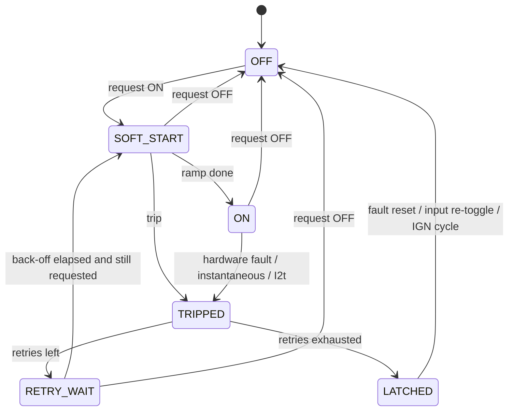

# 07 — Firmware

Target: STM32G0B1, C with STM32 LL drivers (or Rust/Embassy — decision
D-6 in [10-decisions-and-open-questions.md](10-decisions-and-open-questions.md)).
No RTOS is needed; three fixed-rate loops cover the work.

## Execution model

| Loop | Rate | Context | Work |
|---|---|---|---|
| ADC | continuous | DMA | Scan ISENSE ×4, inputs ×4, IGN, VBAT, OUT_SENSE ×4, NTCs; oversample ×8 |
| Protection | 1 kHz | Timer ISR, highest priority | E-fuse, I²t, soft-start ramps, retry timers, apply final output state |
| Logic | 100 Hz | Main loop | Input decode, rule engine, arbitration, load shed, derating |
| Telemetry | 10 Hz | Main loop | `Status`, `Currents`, `Inputs`; `Diag`/`Info` at 1 Hz |
| CAN RX | event | FDCAN ISR → queue | `Command`, `ConfigReq`, vehicle-signal extraction |

The protection loop never waits on the logic loop: it reads the latest
arbitrated request and applies it, so a slow or stuck rule never delays a
trip. The independent watchdog is fed only when both loops have checked in.

## Start-up and reset behaviour (FN-14)

1. Hardware pull-downs hold every `CHn_EN` low through reset, bootloader and
   any period the pins are high-impedance.
2. Firmware loads configuration (A/B pages, CRC-checked), reads slot ID
   resistors and the power-board EEPROM, and compares fitted classes with
   the configuration. Mismatch → that output stays off with
   `SLOT_MISMATCH`.
3. 500 ms start-up inhibit: no output turns on until VBAT has been stable
   above 9 V for 500 ms. This also stops outputs flickering on during cranking.
4. Outputs then follow arbitration. State is not restored across a reset:
   rules re-evaluate from current inputs, and a CAN host has to re-command.

## Output protection state machine (per channel)



### Electronic fuse

Two checks run every 1 ms on the calibrated current `I`, against the
configured rating `In`:

1. **Instantaneous:** `I > k_inst × In` (default 4×) → trip. For the first
   `inrush_ms` after turn-on (default 0 ms for S/M, 300 ms for L) the
   instantaneous limit is raised to the hardware trip level.
2. **I²t thermal model:** a first-order model of conductor heating,
   `θ += (dt/τ) × ((I/In)² − θ)`, trips when `θ > 1.21` (i.e. it never trips
   at ≤ 110 % of rating). Time to trip from cold at `k × In` is
   `−τ ln(1 − 1.21/k²)`:

   | Overload | τ = 10 s (default) |
   |---|---|
   | 1.5 × | 7.7 s |
   | 2 × | 3.6 s |
   | 3 × | 1.4 s |
   | 5 × | 0.5 s |

   θ keeps cooling while the channel is off, so rapid retries cannot ratchet
   a harness hotter than one long overload would.

Retry policy (per output): default 3 retries with back-off 1 s, 5 s, 30 s,
then `LATCHED`. The retry counter clears after 60 s without a trip.
Compressor default: 1 retry, so a seized motor is not hammered.

### System-level limits

| Function | Default | Action |
|---|---|---|
| Module current budget | 80 A total (EL-8) | Fold back PWM-capable outputs, then shed by priority |
| Thermal derating | Board > 85 °C | M-class limit derates linearly to 50 % at 105 °C; > 110 °C everything except `critical` outputs off |
| Low-voltage shed, IGN off | VBAT < 12.0 V for 60 s | Shed outputs with `shed_ign_off: true`; restore at IGN on |
| Low-voltage shed, IGN on | VBAT < 11.5 V for 10 s | Shed by priority (charging system not keeping up) |
| Cranking | VBAT 6–9 V | Hold outputs; no shed; protection thresholds unchanged |

## Rule engine

Autonomous behaviour is **configuration, not code**: a small, fixed set of
function blocks that can be verified once and reused, instead of a scripting
language that would need its own test effort.

Each output has one rule:

```
condition  = term [AND|OR term]...     (up to 4 terms)
term       = source  op  [value]        op: is_on, is_off, >, <, rising, falling
value      = number | hysteresis(low, high)   ("< hysteresis(110, 150)": true
             below 110, false above 150, unchanged in between)
source     = IN1..IN4, IGN, VIN1..VIN8, VS1..VS8 (vehicle signals),
             VBAT, OUT1..OUT4 (state), ENGINE_RUNNING (derived)
behaviour  = follow | toggle | pulse      (what the condition does)
modifiers  = on_delay, off_delay, max_on (auto-off), min_off (cooldown),
             flash pattern, duty, soft_start_ms
```

- `follow`: output on while the condition is true (after delays).
- `toggle`: each rising edge of the condition flips the output — momentary
  buttons and CAN keypad keys.
- `pulse`: a rising edge turns the output on for `max_on`.
- `ENGINE_RUNNING` is derived: VBAT > 13.2 V for 5 s, or a configured
  vehicle RPM signal > 500 when the vehicle bus is active.
- **Local override** inputs: an input can be marked `override` for an output,
  which places it above CAN commands in arbitration
  ([02](02-architecture.md#data-flow-inside-the-mcu)). This is how a physical
  dash switch keeps working when a CAN keypad is present.

Worked example: [`config/jk-example.yaml`](../config/jk-example.yaml).

## Vehicle signal map

Up to 8 vehicle signals `VS1..VS8`, each defined in configuration:

| Field | Example |
|---|---|
| `name` | `vehicle_speed` |
| `can_id` | filled in after sniffing |
| `start_bit`, `length`, `byte_order`, `signed` | DBC-style |
| `factor`, `offset` | scale to engineering units |
| `timeout_ms` | value becomes *stale* after this; rules treat stale as false and `Status.VehicleSignalStale` is set |

FDCAN2 hardware filters are programmed from the map, so the MCU only sees
the frames it needs.

## Configuration storage

- Two flash pages (A/B), each holding the full configuration, a sequence
  number and a CRC-32.
- `COMMIT` writes the inactive page, verifies it, then bumps its sequence —
  power loss during a commit leaves the previous configuration valid.
- Boot loads the valid page with the highest sequence. Neither valid →
  factory defaults: all outputs OFF, no rules, inputs inert, CAN on at
  500 kbit/s so the module can be configured.
- `Info.ConfigCrc16` lets a host detect which configuration a module runs.

## Firmware update

- **USB (rev A):** USB-C service port → ROM DFU bootloader, entered by a
  `ConfigReq` command or by a button on the logic board. Outputs are off
  throughout (pins high-impedance + pull-downs).
- **CAN (later):** custom bootloader on `BootReq`/`BootResp`, A/B image slots,
  image CRC + version check before switching. Lets every module on a bus be
  updated through one connector.

## Source layout (planned)

See [`../firmware/README.md`](../firmware/README.md).
