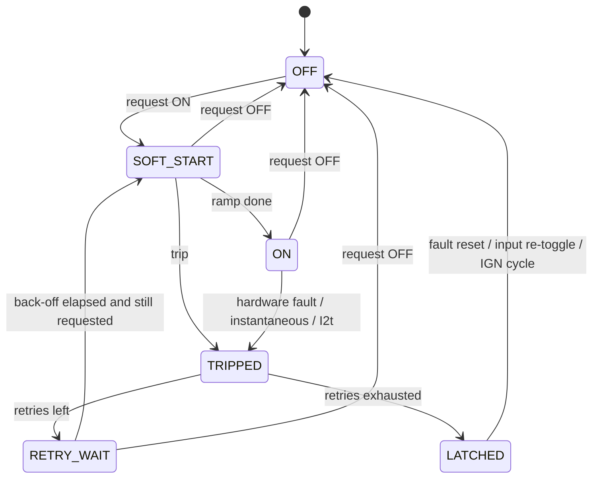

# 07 — Firmware

Target: STM32G474, C with STM32 LL drivers (or Rust/Embassy — decision
D-6 in [10-decisions-and-open-questions.md](10-decisions-and-open-questions.md)).
No RTOS is needed; three fixed-rate loops cover the work.

## Execution model

| Loop | Rate | Context | Work |
|---|---|---|---|
| ADC | continuous | DMA | Scan ISENSE ×4, AUX IS ×2, inputs ×8, IGN, VBAT, multiplexed slow channels; oversample ×8 |
| Protection | 1 kHz | Timer ISR, highest priority | E-fuse, I²t, soft-start ramps, retry timers, `force_off` interlocks, apply final output state |
| Logic | 100 Hz | Main loop | Input decode, vehicle signals, rule engine, arbitration, feedback supervision, load shed, derating |
| Telemetry | 10 Hz | Main loop | `Status`, `Currents`, `Inputs`, `Inputs2`, `Aux`, `VehicleA/B`; `Diag`/`Info`/`Health` at 1 Hz |
| CAN RX | event | FDCAN ISR → queue | FDCAN1: `Command`, `ConfigReq`. FDCAN2/3: vehicle-signal extraction |
| OBD client | 10 Hz max | Main loop | Only when enabled and the `TXD` jumper is fitted ([below](#obd-ii-polling)) |

The protection loop never waits on the logic loop: it reads the latest
arbitrated request and applies it, so a slow or stuck rule never delays a
trip. The independent watchdog is fed only when both loops have checked in.

## Start-up and reset behaviour (FN-14)

1. Hardware pull-downs hold every `CHn_EN` and `AUXn_IN` low through reset,
   bootloader and any period the pins are high-impedance.
2. Firmware loads configuration (A/B pages, CRC-checked), reads slot ID
   resistors and the power-board EEPROM, and compares fitted classes with
   the configuration. Mismatch → that output stays off with
   `SLOT_MISMATCH`.
3. 500 ms start-up inhibit: no output turns on until VBAT has been stable
   above 9 V for 500 ms. This also stops outputs flickering on during cranking.
4. Outputs then follow arbitration. State is not restored across a reset:
   rules re-evaluate from current inputs, and a CAN host has to re-command.
   (A winch isolator therefore opens if the module resets; the hardwired
   override is the path that does not depend on the module.)

## Output protection state machine (per channel)



AUX outputs use the same machine with a zero-length soft start.

### Electronic fuse

Two checks run every 1 ms on the calibrated current `I`, against the
configured rating `In`:

1. **Instantaneous:** `I > k_inst × In` (default 4×) → trip. For the first
   `inrush_ms` after turn-on (default 0 ms for S/M, 300 ms for L, 150 ms for
   AUX so a contactor's pull-in current passes) the instantaneous limit is
   raised to the hardware trip level.
2. **I²t thermal model:** a first-order model of conductor heating,
   `θ += (dt/τ) × ((I/In)² − θ)`, trips when `θ > 1.21` (i.e. it never trips
   at ≤ 110 % of rating). Time to trip from cold at `k × In` is
   `−τ ln(1 − 1.21/k²)`:

   | Overload | τ = 10 s (default) |
   |---|---|
   | 1.5 × | 7.7 s |
   | 2 × | 3.6 s |
   | 3 × | 1.4 s |
   | 5 × | 0.5 s |

   θ keeps cooling while the channel is off, so rapid retries cannot ratchet
   a harness hotter than one long overload would.

Retry policy (per output): default 3 retries with back-off 1 s, 5 s, 30 s,
then `LATCHED`. The retry counter clears after 60 s without a trip. Coil
outputs default to 1 retry: a shorted coil wire is not a transient.

Open load: with `open_load_a` set, an on-state current below it for 100 ms
raises the `OPEN_LOAD` warning (no action; the output stays on). Unset means
no check — leave it unset on flashing loads such as a strobe, and on loads
inside a channel's low-current error band (FN-3: ±0.3 A on the main outputs).

### System-level limits

| Function | Default | Action |
|---|---|---|
| Module current budget | 60 A for `MMSS`, 80 A for `LMSS` (EL-8) | Fold back PWM-capable outputs, then shed by priority |
| Thermal derating | Estimated junction > 125 °C, per channel (board NTC + that channel's loss × its R<sub>th</sub>, calibrated in TH-1) | PWM-capable outputs fold back duty, others shed by priority, until the estimate is back under 120 °C; board > 115 °C → everything except `critical` outputs off. Working on estimated junction temperature rather than fixed board thresholds lets the same firmware run the cab and engine-bay builds. |
| Low-voltage shed, IGN off | `VBAT_EST` < 12.0 V for 60 s (per-output `shed_v`, `shed_delay_s`, `restore_v` override) | Shed outputs with `shed_ign_off: true`; restore at IGN on or above `restore_v` |
| Low-voltage shed, IGN on | `VBAT_EST` < 11.5 V for 10 s | Shed by priority (charging system not keeping up) |
| Cranking / winching | VBAT 6–9 V | Hold outputs; no shed; protection thresholds unchanged |
| Supply limit, per output | `max_supply_v`, unset by default | VBAT above it for 50 ms → that output off with `OVERVOLTAGE`; back on, if still requested, once VBAT has stayed 0.5 V below it for 1 s. For 12 V-only loads — the RIGID Chase is rated 9–15 V — during a 24 V jump start or with a failed regulator. Uses the module's own VBAT, which is what its loads see. The module itself rides through 24 V (EL-4); outputs without the field stay on. |

## Rule engine

Autonomous behaviour is **configuration, not code**: a small, fixed set of
function blocks that can be verified once and reused, instead of a scripting
language that would need its own test effort.

Each output (main or AUX) has one rule:

```
condition  = expr                       drives the behaviour
force_off  = expr                       optional interlock: while true the output is off
expr       = term [AND|OR term]...      (up to 4 terms, evaluated left to right)
term       = source op [value] [for <ms>]
op         = is_on | is_off | > | < | rising | falling
value      = number | hysteresis(low, high)   ("< hysteresis(110, 150)": true
             below 110, false above 150, unchanged in between)
for <ms>   = the comparison must have held for <ms> (long press, persistence)
source     = local | remote
local      = IN1..IN8, IGN, VIN1..VIN8, VS1..VS8 (vehicle signals), VBAT,
             IN1_TURN..IN8_TURN, IN1_BRAKE..IN8_BRAKE (FREQUENCY-mode decode),
             OUT1..OUT4 / AUX1..AUX4 / KA1..KA2 (state), OUT1_I..AUX4_I (current, A),
             OUT1_FAULT..AUX4_FAULT (a fault is present),
             ENGINE_RUNNING, VBAT_SAG, VBAT_EST (derived)
remote     = M<address>.<s>, where <s> is one of IN1..IN8, IGN, VS1..VS8,
             VBAT, OUT1..OUT4, AUX1..AUX4, OUT1_I..AUX4_I  (a peer module's
             broadcast values, see "Peer signals")
behaviour  = follow | toggle | pulse | always
modifiers  = on_delay, off_delay, min_off (cooldown),
             max_on (auto-off) + max_on_defer (expr) + max_on_warning_s,
             max_load_on_s + load_on_threshold_a (continuous-run limit),
             flash: [{when: expr, pattern: slow|fast}]  (first match wins),
             duty, soft_start_ms
```

- `follow`: output on while the condition is true (after delays).
- `toggle`: each rising edge of the condition flips the output — momentary
  buttons and panel keys. With `for`, a toggle becomes a long-press action.
- `pulse`: a rising edge turns the output on for `max_on`.
- `always`: on whenever it is not forced off, shed or tripped — for feeds
  such as a fridge. Needs no `condition`.
- `max_on_defer` holds the `max_on` timer at its limit while the expression
  is true (the winch isolator does not time out while the winch is pulling);
  `max_on_warning_s` raises a warning flag for the panel before it expires.
- A vehicle signal that is stale or unverified makes every comparison on it
  false — so put vehicle signals in `force_off` (a missing signal then
  removes the interlock) or in optional extras, never as a requirement for
  turning something on.
- `force_off` is evaluated in the protection layer, above CAN commands and
  local overrides: it is how interlocks such as "compressor only with the
  engine running" or "winch isolator opens when driving" cannot be bypassed
  from the panel. It cannot touch hardware outside the module (the winch
  override switch).
- `max_load_on_s` trips `RUN_LIMIT` when the output's *current* has stayed
  above `load_on_threshold_a` continuously for that long — the compressor's
  continuous-run limit ([12](12-compressor-and-winch.md#run-detection-without-a-pressure-sensor)).
- `ENGINE_RUNNING` is derived: an RPM vehicle signal > 500, or VBAT > 13.2 V
  for 5 s when no RPM signal is configured or it is stale.
- `VBAT_SAG` is derived: VBAT more than 1 V below its 10 s average — a large
  load such as a winch is pulling.
- A `FREQUENCY`-mode input reads `is_on` while its signal is present —
  steady, or toggling within the last 1.5 s — so a peer sees "turn or brake
  activity" through `M<address>.INx`; `INx_TURN` and `INx_BRAKE` give the
  decoded meaning locally.
- `VBAT_EST` is derived: VBAT + module current × `feed_resistance_mohm` — the
  battery voltage seen through a long feed (the rear module). Without a feed
  resistance configured it equals VBAT. Load shed uses it.
- **Local override** inputs: an input can be marked `override` for an output,
  which places it above CAN commands in arbitration
  ([02](02-architecture.md#data-flow-inside-the-mcu)). This is how a physical
  dash switch keeps working when a CAN panel is present.

Worked examples: [`config/jk-front.yaml`](../config/jk-front.yaml) and
[`config/jk-rear.yaml`](../config/jk-rear.yaml).

## Peer signals

Several modules share one accessory bus as peers; none is a master
([13](13-multi-module-system.md#peer-signals)).

- A module's `peers` list (configuration) names the addresses it reads.
  FDCAN1 filters accept those peers' `Status`, `Currents`, `Aux`, `Inputs`,
  `Inputs2` and `VehicleA/B` frames, and the values become remote sources
  `M<address>.<s>`.
- A remote value is stale after three of its sender's periods: 300 ms while
  the sender has IGN on, 30 s while it is parked (from the sender's last
  `IGN_Active`). Stale reads false, exactly like a stale vehicle signal, so
  the same rule of thumb applies: use remote values in `force_off` or as
  optional extras, not as the only way to turn something on.
- `VIN` bits are not peer data: the panel addresses each module's `Command`
  frame separately.
- `ign_source: M<address>.IGN` lets a module without its own ignition wire
  follow a peer's ignition (fallback only — a wired `IGN` also wakes the
  module directly).

## Parked mode

With IGN off and no host `Command` for 30 s a module is *parked*: it sends
`Status` every 10 s while any output is on and nothing once all outputs are
off (then it sleeps). Every state change still goes out at once, as a burst
of three `Status` frames 50 ms apart, so a sleeping peer woken by the first
frame receives the others. A module woken by bus activity listens for up to
100 ms and goes back to sleep unless a `Command` addresses it or a peer frame
changes one of its rules. This keeps one module's overnight load (a fridge)
from holding every other module awake
([13](13-multi-module-system.md#sleep-and-wake-with-two-modules)).

## Keep-alive outputs

`KA1` and `KA2` hold lamp electronics booted between flashes
([14](14-lamp-keep-alive-and-bluetooth.md)). They take a rule like any other
output, plus:

| Field | Meaning |
|---|---|
| `level_v` | Keep-alive level at the lamp, 5.0–8.0 V; the DAC sets the rail ~0.3 V higher to cover the injection diode |
| `current_limit_a` | eFuse limit, default 0.5 A |
| `expect_a` | `[min, max]` current band while on; outside it → `KA_Fault` |
| `dip_check_while` | Expression that is true while the factory flasher drives the lamps (e.g. the rear module's stop/turn inputs). During each flash the keep-alive current must dip; if it does not, the factory path (D_f) is open → `FEEDBACK_MISMATCH` |

Keep-alive is off whenever the module is parked and the rule is false; it is
never on in sleep.

## Feedback supervision

Any output may name inputs that must follow its real-world state (FN-16):

| Field | Meaning |
|---|---|
| `sense` | Input that is high when the load side is live (e.g. winch-side contactor stud) |
| `command_sense` | Optional input on the coil side; high when *anything* — this output or a hardwired override — energises the coil |
| `close_timeout_ms` | `sense` must go high within this time after the coil is energised |
| `open_timeout_ms` | `sense` must go low within this time after the coil is released |

Expected state = this output on, **or** `command_sense` high. A mismatch past
the timeout raises `FEEDBACK_MISMATCH` on that output. The winch isolator
uses this to detect a contactor that failed to close, welded contacts, and
an override switch left on ([12](12-compressor-and-winch.md#state-and-feedback)).

## Vehicle signal map

Up to 8 vehicle signals `VS1..VS8`, each defined in configuration:

| Field | Example |
|---|---|
| `name` | `high_beam` |
| `bus` | `CAN3` (CAN-IHS) or `CAN2` (OBD port) |
| `type` | `broadcast` (decode a frame on the bus) or `obd_pid` (poll, CAN2 only) |
| `can_id`, `start_bit`, `length`, `byte_order`, `signed` | DBC-style, for `broadcast` |
| `pid` | e.g. `0x0D`, for `obd_pid`; the standard SAE J1979 formula is applied |
| `factor`, `offset`, `scale` | Engineering units, and the unit reported in `VehicleA/B` |
| `timeout_ms` | Value becomes *stale* after this; rules treat stale as false and `Status.VehicleSignalStale` is set |

FDCAN2/FDCAN3 hardware filters are programmed from the map, so the MCU only
sees the frames it needs.

### OBD-II polling

Runs only when all of these hold: the CAN2 `TXD` jumper is fitted, polling
is enabled in configuration, at least one `obd_pid` signal is configured,
and IGN is on.

- Transmits only ID `0x7DF`, mode `0x01`, configured PIDs; ≤ 10 requests/s
  in total.
- Automatic retransmission is disabled; any transmit error or bus-off stops
  polling until the next ignition cycle.
- Pauses for 30 s whenever another tester's requests appear on the bus
  (`Health.OtherTesterSeen`).
- Never runs on FDCAN3; there is no transmit path to CAN-IHS in hardware.

## Configuration storage

- Two flash pages (A/B), each holding the full configuration, a sequence
  number and a CRC-32.
- `COMMIT` writes the inactive page, verifies it, then bumps its sequence —
  power loss during a commit leaves the previous configuration valid.
- Boot loads the valid page with the highest sequence. Neither valid →
  factory defaults: all outputs OFF, no rules, inputs inert, vehicle buses
  listen-only, CAN1 on at 500 kbit/s so the module can be configured.
- `Info.ConfigCrc16` lets a host detect which configuration a module runs.

## Firmware update

- **USB (rev A):** USB-C service port → ROM DFU bootloader, entered by a
  `ConfigReq` command or by a button on the logic board. Outputs are off
  throughout (pins high-impedance + pull-downs).
- **CAN (later):** custom bootloader on `BootReq`/`BootResp`, A/B image slots,
  image CRC + version check before switching. Lets every module on a bus be
  updated through one connector.

## Source layout (planned)

See [`../firmware/README.md`](../firmware/README.md).
