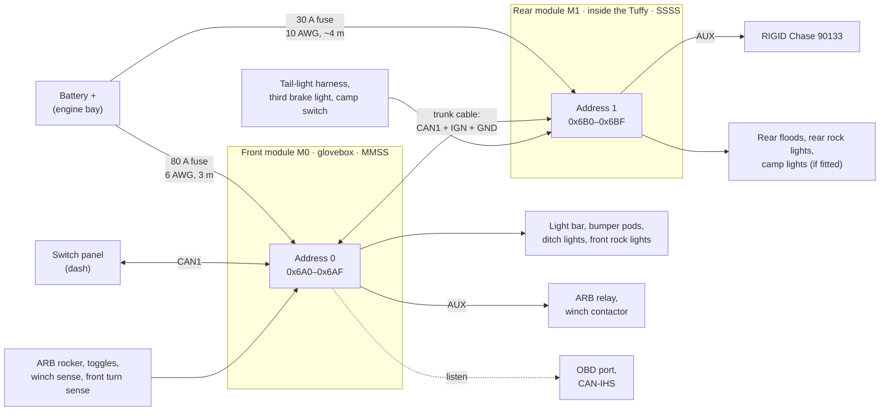

# 13 — Two-module JK system (glovebox + rear)

The architecture has always allowed up to four modules on one accessory bus
(FN-11). The JK build uses two: a **front module in the glovebox** and a
**rear module in the cargo area**, inside the Tuffy 282-01 enclosure. Same
boards, same firmware; each module has its own power-board variant, address
and configuration file. Loads are switched near where they are, which
shortens the runs and puts the rear lamp signals next to the module that uses
them.

## Layout

## Who does what

| | Front module (M0) | Rear module (M1) |
|---|---|---|
| Location | Glovebox (passenger side, cab) | Inside the Tuffy 282-01 cargo enclosure, on a wall clear of the lid and shelves |
| Address / IDs | 0 → `0x6A0–0x6AF` | 1 → `0x6B0–0x6BF` |
| Variant | `MMSS` | `SSSS` — or an AUX-only build if the Chase stays the only rear light |
| OUT1 | Light bar (M) | Rear floods (S) — placeholder |
| OUT2 | Bumper pods (M) | Rear rock lights (S, PWM) — placeholder |
| OUT3 | Ditch lights (S) | Chase courtesy light (S) |
| OUT4 | Front rock lights (S, PWM) | Camp lights (S, PWM) — placeholder |
| AUX | ARB relay (compressor in the engine bay), winch contactor, rocker indicator, spare | RIGID Chase: power/running, brake, strobe, white reverse/area |
| Keep-alive | KA1 → front turn-lamp injectors | Spare (Chase, if it boots slowly) |
| Inputs | ARB rocker, ditch/bar/pods toggles, winch sense ×2, front turn sense ×2 | Reverse, stop/turn ×2 and tail lamps from the tail-light connectors, third brake light, camp switch |
| Vehicle CAN | OBD port + CAN-IHS taps (short stubs from the glovebox) | None — reads them through M0 |
| Power | 6 AWG, 80 A fuse at the battery | Own feed: 10 AWG, 30 A fuse at the battery |
| Configuration | [`config/jk-front.yaml`](../config/jk-front.yaml) | [`config/jk-rear.yaml`](../config/jk-rear.yaml) |

### RIGID Chase 90133

A rear-facing pod: red halo with strobe, running and brake modes, a 715 lm
white centre light for reverse or area use, and a downward courtesy light.
It takes its functions on separate trigger wires and arbitrates between them
itself. Owners report a 6-wire cable (red power/running, black ground, white
brake, and three more triggers), but the reports disagree, so the wire map
must come from RIGID's 90133 instruction sheet before wiring (Q-24). The
rear module drives it from the AUX bank (5 A per output, far above the
Chase's needs) and the spare S slot:

| Chase function | Output | Rule |
|---|---|---|
| Power / running (halo) | AUX1 | Tail lamps, brake, reverse or strobe requested |
| Brake (halo) | AUX2 | Third brake light (IN2), 10 ms debounce |
| Strobe (halo) | AUX3 | Panel button only; off with the ignition. Red strobes to the rear are restricted on public roads. |
| White reverse / area | AUX4 | Reverse, or the panel area-light button; off above 15 km/h |
| Courtesy (downward) | OUT3 | Camp switch or panel |

If the Chase is mounted on the tailgate or spare carrier, its cable crosses
the tailgate hinge: use a flexible 6-conductor cable through the hinge boot
and a sealed DT 6-way at the tailgate side for service.

## Power

No rear battery and no fridge, so the rear module's own feed only has to
carry lights. The rear loads come to about 18 A even with every placeholder
fitted, so the default feed drops from 8 AWG / 50 A to **10 AWG with a 30 A
fuse** (or manual-reset breaker) at the battery:

| Module | Run | Current (A) | AWG | One-way (m) | Drop (V) | Drop at 13.5 V (%) |
|---|---|---:|---:|---:|---:|---:|
| Front | Battery feed to the glovebox module | 60 | 6 | 3.0 | 0.23 | 1.7 |
| Rear | Battery feed to the rear module, 10 AWG, at the 30 A fuse | 30 | 10 | 4.0 | 0.39 | 2.9 |
| Rear | Same 10 AWG feed at the expected 18 A | 18 | 10 | 4.0 | 0.24 | 1.7 |

(From `python3 tools/budget.py`, 20 °C copper. Feeding M1 from an M0 output
remains a bad idea: it is limited to that output's rating, stacks two
voltage drops, and M1 loses its supply — and cannot wake — whenever the
output is off.)

- **Battery voltage estimate.** Under load the rear module reads its supply
  lower than the battery by `I × R_feed`. With `feed_resistance_mohm`
  configured (13.1 mΩ for 4 m of 10 AWG), firmware derives `VBAT_EST` and
  uses it for load shed, so the camp-light cut-off acts on battery voltage
  rather than on cable drop.
- **Grounds.** M1 grounds to a body point at the rear (12 AWG). The trunk
  cable carries a signal ground so the two modules' CAN references stay
  close; the transceivers tolerate several volts of common-mode offset
  anyway.

The output runs for both modules are in [08](08-mechanical-and-wiring.md#harness).

## Accessory bus and trunk cable

- **Trunk cable, front to rear:** CAN1-H/L as a twisted pair, `IGN` (18 AWG,
  from the same TIPM tap) and a signal ground (18 AWG), with an inline DT
  4-way at each end for service. Route it along the factory harness path
  under the sill trim, away from seat-belt and SRS wiring; the 10 AWG feed
  runs in its own loom.
- **Topology:** panel (dash) — M0 — M1, about 4–5 m in total on the two-door,
  far inside CAN's limits at 500 kbit/s. Terminate the two physical ends: the
  panel and M1. Until the panel exists, terminate M0 and M1. With everything
  unpowered, CAN-H to CAN-L must measure ~60 Ω.
- **IDs and load:** module 1 uses `0x6B0–0x6BF`. Both modules plus the
  panel's commands put 166 periodic frames/s on the bus, ≈ 4.5 % of
  500 kbit/s. [`can/pcm-jk.dbc`](../can/pcm-jk.dbc) covers both modules; it is
  generated from `can/pcm.dbc` by `python3 tools/gen_dbc.py --modules 2 --out can/pcm-jk.dbc`.
- **Panel:** a host to each module — it sends a `Command` frame to each
  address and maps each button to a (module, `VIN`) pair.

## Peer signals

There is no master. Every module already broadcasts its `Status`,
`Currents`, `Aux`, `Inputs` and `VehicleA/B` frames; a module lists its peers
in configuration and reads theirs. Rules then use a peer's values as
`M<address>.<source>` ([07](07-firmware.md#rule-engine)):

| Rule on the rear module | Uses |
|---|---|
| Chase reverse light and rear floods off above 15 km/h | `M0.VS2` — vehicle speed decoded by the front module |
| Rear rock lights follow the front rock lights | `M0.OUT4` |
| ENGINE_RUNNING on the rear module | `M0.VS1` (RPM) |

A peer value goes stale after three of its sender's periods; stale reads
false, like a stale vehicle signal. So:

| Failure | Front module | Rear module |
|---|---|---|
| Front module dead or unpowered | — | Local rules keep running (Chase running/brake/reverse from the lamp wires, camp and courtesy lights); rules needing M0 values fall back safe (no speed interlock means the reverse light still needs reverse to come on) |
| Rear module dead | Unaffected | — |
| Trunk cable cut | Runs its local rules | Runs its local rules; M0 values stale |
| Panel dead | `on_host_loss` per output | `on_host_loss` per output |

## Sleep and wake with two modules

A transceiver in standby wakes on *any* bus traffic, so a module kept awake
overnight (the rear module running the camp lights at a campsite) would keep
waking the other. Rules (FN-18):

1. **Parked** = IGN off and no host `Command` for 30 s.
2. A parked module with any output on sends `Status` every 10 s; with all
   outputs off it sends nothing and goes to sleep.
3. Every state change is sent as a burst of three `Status` frames 50 ms
   apart, so a peer woken by the first frame receives the next two.
4. A module woken by bus activity listens for up to 100 ms and stays awake
   only if a `Command` addresses it or a peer frame changes the result of one
   of its rules; otherwise it goes straight back to sleep.
5. Peer values time out at three of the sender's periods: 300 ms normally,
   30 s from a parked sender (the receiver knows from the sender's last
   `IGN_Active`).

Estimated cost: with camp lights running on M1 for an evening, M0 wakes six
times a minute for ≤ 100 ms, ≈ 0.15 mA averaged. Selective-wake transceivers
(TI TCAN1145-Q1, NXP TJA1145A — ISO 11898-2:2016 partial networking) would
remove those wake-ups by waking only on configured frames; they are an option
for a later revision. With everything parked, the system draws about
2 × 195 µA + the panel's ≤ 100 µA ≈ 0.5 mA.

## Thermal

From `python3 tools/budget.py` — hottest junction / enclosure base (°C),
bold = over a limit. The closed glovebox is modelled as a second box around
the module (assumed +4 K/W); the closed steel Tuffy enclosure as +2 K/W.

| Case | Build | Loads (A) | Aluminium box | Printed shell + Al plate | Printed shell only |
|---|---|---|---:|---:|---:|
| Front, closed glovebox | MMSS | rated | 125 / 100 | 132 / 107 | **154** / **129** |
| Front, closed glovebox | MMSS | 20, 12, 6, 3 | 110 / 85 | 114 / 89 | 127 / 102 |
| Front, vented glovebox or plate on dash metal | MMSS | 20, 12, 6, 3 | 96 / 71 | 99 / 74 | 112 / 87 |
| Rear, inside the Tuffy enclosure | SSSS | rated | 92 / 79 | 96 / 83 | 110 / 97 |
| Rear, inside the Tuffy enclosure | SSSS | 8, 4, 0, 4 | 78 / 70 | 80 / 71 | 84 / 76 |

- **Front:** fine in a closed glovebox at the expected loads (114 °C
  junction, 89 °C base — under ASA's 100 °C). With every slot at its rating
  the base reaches 107 °C, past ASA, so for full-rating use vent the bin's
  back wall into the dash cavity, bolt the plate through the bin to a metal
  dash member (the "plate on dash metal" row), or print the shell in PC or
  PET-CF.
- **Rear:** runs cool even inside the closed Tuffy. Printed-only stays
  under the electronics limits but puts the shell at 97 °C at full rating,
  close to ASA's 100 °C, so keep the aluminium plate — bolted to the Tuffy's
  steel wall it also spreads the heat into the enclosure.

## Installation notes

**Glovebox (front):**

- Fit-check the 160 × 120 × 50 mm envelope with a PLA print first; the
  module takes a good part of the bin.
- The harness leaves through a grommet in the back wall of the bin.
- The passenger airbag sits in the dash above the glovebox: keep the
  module, brackets and harness out of the airbag module's space and
  deployment path, and away from the yellow SRS wiring.
- Upside: the USB service port and status LED are reachable by opening the
  glovebox. The OBD port and the radio/cluster CAN-IHS taps are short runs
  away.

**Rear (inside the Tuffy 282-01):**

- The Tuffy spans the cargo area (listed at 52 × 19 × 9, most likely inches)
  with a lockable lid and removable shelves. Bolt the module's base plate to
  an inside wall, clear of the lid's swing and the shelves; the module is
  then out of sight, locked away and out of the weather.
- Harness in and out through grommeted holes in the Tuffy wall (feed, trunk
  cable, lamp taps, Chase cable). Keep the holes low on a side wall, away
  from the tailgate seal and the window drain path.
- Open the lid to reach the USB service port.
- **Brake signal:** the tail-light circuits carry combined stop/turn, which
  needs ~0.7 s to tell braking from a turn signal. The third brake light on
  the spare-tire carrier has its own two-wire harness (reached behind the
  tailgate trim); confirm with a meter that it is live only with the pedal
  pressed, and use it as the instant brake input for the Chase.

## Open questions for this layout

Q-23 (which rear loads besides the Chase will be fitted — decides `SSSS`
versus an AUX-only rear build) and Q-24 (the Chase's wire map) — see
[10](10-decisions-and-open-questions.md#open-questions). Answered: compressor
in the engine bay (Q-15), no rear battery and no fridge (Q-16), two-door
(Q-17).
