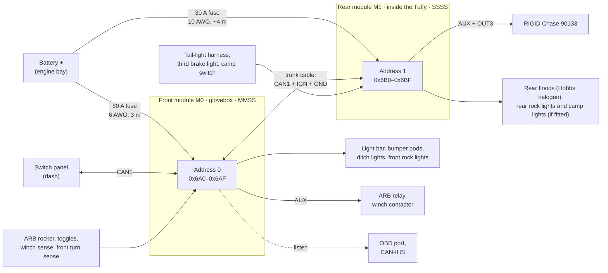

# 13 — Two-module JK system (glovebox + rear)

The architecture has always allowed up to four modules on one accessory bus
(FN-11). The JK build uses two: a **front module in the glovebox** and a
**rear module in the cargo area**, inside the Tuffy 282-01 enclosure. Same
boards, same firmware; each module has its own power-board variant, address
and configuration file. Loads are switched near where they are, which
shortens the runs and puts the rear lamp signals next to the module that uses
them.

## Layout

## Who does what

| | Front module (M0) | Rear module (M1) |
|---|---|---|
| Location | Glovebox (passenger side, cab) | Inside the Tuffy 282-01 cargo enclosure, on a wall clear of the lid and shelves |
| Address / IDs | 0 → `0x6A0–0x6AF` | 1 → `0x6B0–0x6BF` |
| Variant | `MMSS` | `SSSS` — the rear floods need a main output, so an AUX-only build is no longer an option |
| OUT1 | Light bar (M) | Rear floods: Hobbs 4×6 halogen (S, soft start) |
| OUT2 | Bumper pods (M) | Rear rock lights (S, PWM) — placeholder |
| OUT3 | Ditch lights (S) | Chase courtesy light, green wire (S) |
| OUT4 | Front rock lights (S, PWM) | Camp lights (S, PWM) — placeholder |
| AUX | ARB relay (compressor in the engine bay), winch contactor, rocker indicator, spare | RIGID Chase: trail (red), brake (white), strobe (yellow), reverse (blue) |
| Keep-alive | KA1 → front turn-lamp injectors | Unused (the Chase is rated 9–15 V) |
| Inputs | ARB rocker, ditch/bar/pods toggles, winch sense ×2, front turn sense ×2 | Reverse, stop/turn ×2 and tail lamps from the tail-light connectors, third brake light, camp switch |
| Vehicle CAN | OBD port + CAN-IHS taps (short stubs from the glovebox) | None — reads them through M0 |
| Power | 6 AWG, 80 A fuse at the battery | Own feed: 10 AWG, 30 A fuse at the battery |
| Configuration | [`config/jk-front.yaml`](../config/jk-front.yaml) | [`config/jk-rear.yaml`](../config/jk-rear.yaml) |

### RIGID Chase 90133

A rear-facing pod: red halo with trail, brake and strobe functions, a white
reverse light and a downward courtesy light. RIGID's installation sheet
(PKG-IS-215-A) gives the wire map and the current of each function. Every
function has its own feed wire; there is no separate power wire. The sheet
says nothing about which function wins when several are on, so SY-7 records
that on the bench.

| Wire | Function (RIGID) | Current at 14 V | Output | Rating / open-load threshold | Rule |
|---|---|---:|---|---|---|
| Red | Low power / trail light | 0.3 A | AUX1 | 1 A / 0.1 A | Tail lamps (IN5); off with the ignition |
| White | High power / brake light | 1.3 A | AUX2 | 2 A / 0.4 A | Third brake light (IN2), 10 ms debounce |
| Yellow | High power strobe flash | 1.3 A | AUX3 | 2 A / none (flashing load) | Panel button only; off with the ignition and while braking. Red strobes to the rear are restricted on public roads. |
| Blue | Reverse light | 0.7 A | AUX4 | 1.5 A / 0.2 A | Reverse, or the panel area-light button; off above 15 km/h |
| Green | Cargo / courtesy light | 0.3 A | OUT3 (S) | 1 A / none (inside the S channel's ±0.3 A low-current error) | Camp switch or panel |
| Black | Ground | — | J7 GND | — | — |

All five on draw 3.9 A. Ratings are about 1.5 × the 14 V current, leaving
room for LED drivers that draw more at low supply voltage.

- **Supply range.** RIGID rates the Chase for 9–15 V only and warns that
  24 V damages it. So it gets no keep-alive (5–8 V is below its range; the
  rear module's KA outputs stay unused), and every Chase output carries
  `max_supply_v: 16.0`: a 24 V jump start or a failed regulator switches the
  Chase off instead of destroying it (FN-21,
  [07](07-firmware.md#system-level-limits)). 16 V sits above the JK's normal
  charging voltage, so a cold battery on charge does not trip it; the band
  between RIGID's 15 V and the 16 V limit is only reached with a charging
  fault. The factory brake lamps are not affected.
- **Brake over strobe.** Until SY-7 shows how the light prioritises its
  functions, the strobe is forced off while the brake input is on, so
  braking always shows as a steady brake light.
- **No PWM** on any Chase wire: each one feeds the light's own driver.
- **Cable.** RIGID's pigtail has six wires: five go to J7 (AUX1–4 and GND),
  the green one to J4 (OUT3). If the Chase is mounted on the tailgate or
  spare carrier, its cable crosses the tailgate hinge: use a flexible
  6-conductor cable through the hinge boot and a sealed DT 6-way at the
  tailgate side for service. The Chase mounts on 1.75" or 2" tube with its
  clamp, or on a flat surface with its universal bracket.

### Rear floods (Hobbs halogen)

The owner's photos show Hobbs-branded 4×6 sealed halogen work floods: a
fluted flood lens marked "SEALED BEAM", a yoke bracket, and a black rubber
cord printed with MSHA approval P-7K-123033, which Carol prints on its SJOOW
(300 V) and SOOW (600 V) cords, 18–10 AWG. Hobbs' 4×6 range is 12 V at 35,
35/65, 50 or 60 W and 24 V at 60 W; its 12 V 50 W flood spreads 80° × 30°.
No rating label is visible in the photos, and an MSHA cord points to mining
or industrial equipment, where 24 V is common, so confirm the voltage before
wiring:

| Check | How | Result |
|---|---|---|
| Label | Part number or rating on the housing, or on the back of the sealed beam (remove the bezel) | e.g. Hobbs 71723: 12 V 50 W stud-mount flood |
| Bench test | One lamp on a 12 V battery, clamp meter on one wire | 12 V lamp: full white light at ~2.7 A (35 W), ~3.9 A (50 W) or ~4.7 A (60 W). 24 V lamp: dim orange light at about 1.7 A — fit a 12 V sealed beam or a 4×6 LED insert |
| Cord | Gauge in the jacket print (e.g. "16/2 SJOOW") | 16 AWG or larger per lamp |

OUT1 settings, assuming two 12 V 50 W lamps (`rear_floods` in
[`config/jk-rear.yaml`](../config/jk-rear.yaml)):

- **Current:** ~7.8 A at 12.8 V, ~8.3 A at 14.2 V — inside the S slot's
  10 A rating and the 8 A the budgets already assumed.
- **Cold-filament inrush:** a cold tungsten filament draws roughly ten times
  its running current until it heats up — about 80 A for the pair. Switched
  straight on, that trips the firmware's instantaneous limit (4 × rating)
  and drives the PROFET into its own current limit. OUT1 therefore ramps on
  with PWM over 300 ms (`soft_start_ms`), which warms the filaments first,
  with the instantaneous limit held at the hardware level for the same time
  (`inrush_ms`). The ramp also spares the filaments. SY-8 measures the real
  inrush; if the S cell still current-limits or overheats, the fallbacks are
  an M cell in slot 1 or LED inserts.
- **Dimming:** halogen follows PWM cleanly (unlike LED drivers with their
  own electronics), so OUT1 can also run dimmed as an area light; the
  default is 100 %.
- **Supply limit:** `max_supply_v: 16.0` — a 12 V filament on 24 V draws
  about 1.5 × its current at nearly three times its power, and burns out.
- **One lamp out:** after SY-8, set `open_load_a` to ~75 % of the measured
  pair current, so one dead lamp of the two raises `OPEN_LOAD`.
- **Wiring:** join each lamp cord to the 14 AWG run at a sealed splice
  (adhesive-lined heat shrink or a DT 2-way). On the photographed housing
  the cord entry shows a gap and a torn seal: reseal it with a cable gland
  or an adhesive-lined boot before the lamp goes outside.
- **Mounting:** with glass sealed beams these lamps are heavy, and a hot
  filament dislikes the shock of a slammed tailgate. Prefer a fixed mount,
  such as the rear bumper or a body bracket, over the tailgate or spare
  carrier. 4×6 LED inserts (typically 1–3 A each, no filament inrush,
  indifferent to vibration) are the alternative; with them, re-check the
  soft start (an LED driver may not follow PWM) and the open-load
  threshold.

## Power

No rear battery and no fridge, so the rear module's own feed only has to
carry lights. The rear loads come to about 20 A with everything fitted and on
at once (floods 8 A for two 12 V 50 W lamps, rock lights 4 A, camp lights
4 A, Chase 3.9 A), so the default feed drops from 8 AWG / 50 A to **10 AWG
with a 30 A fuse** (or manual-reset breaker) at the battery:

| Module | Run | Current (A) | AWG | One-way (m) | Drop (V) | Drop at 13.5 V (%) |
|---|---|---:|---:|---:|---:|---:|
| Front | Battery feed to the glovebox module | 60 | 6 | 3.0 | 0.23 | 1.7 |
| Rear | Battery feed to the rear module, 10 AWG, at the 30 A fuse | 30 | 10 | 4.0 | 0.39 | 2.9 |
| Rear | Same 10 AWG feed at the expected 20 A | 20 | 10 | 4.0 | 0.26 | 1.9 |

(From `python3 tools/budget.py`, 20 °C copper. Feeding M1 from an M0 output
remains a bad idea: it is limited to that output's rating, stacks two
voltage drops, and M1 loses its supply — and cannot wake — whenever the
output is off.)

- **Battery voltage estimate.** Under load the rear module reads its supply
  lower than the battery by `I × R_feed`. With `feed_resistance_mohm`
  configured (13.1 mΩ for 4 m of 10 AWG), firmware derives `VBAT_EST` and
  uses it for load shed, so the camp-light cut-off acts on battery voltage
  rather than on cable drop.
- **Grounds.** M1 grounds to a body point at the rear (12 AWG). The trunk
  cable carries a signal ground so the two modules' CAN references stay
  close; the transceivers tolerate several volts of common-mode offset
  anyway.

The output runs for both modules are in [08](08-mechanical-and-wiring.md#harness).

## Accessory bus and trunk cable

- **Trunk cable, front to rear:** CAN1-H/L as a twisted pair, `IGN` (18 AWG,
  from the same TIPM tap) and a signal ground (18 AWG), with an inline DT
  4-way at each end for service. Route it along the factory harness path
  under the sill trim, away from seat-belt and SRS wiring; the 10 AWG feed
  runs in its own loom.
- **Topology:** panel (dash) — M0 — M1, about 4–5 m in total on the two-door,
  far inside CAN's limits at 500 kbit/s. Terminate the two physical ends: the
  panel and M1. Until the panel exists, terminate M0 and M1. With everything
  unpowered, CAN-H to CAN-L must measure ~60 Ω.
- **IDs and load:** module 1 uses `0x6B0–0x6BF`. Both modules plus the
  panel's commands put 166 periodic frames/s on the bus, ≈ 4.5 % of
  500 kbit/s. [`can/pcm-jk.dbc`](../can/pcm-jk.dbc) covers both modules; it is
  generated from `can/pcm.dbc` by `python3 tools/gen_dbc.py --modules 2 --out can/pcm-jk.dbc`.
- **Panel:** a host to each module — it sends a `Command` frame to each
  address and maps each button to a (module, `VIN`) pair.

## Peer signals

There is no master. Every module already broadcasts its `Status`,
`Currents`, `Aux`, `Inputs` and `VehicleA/B` frames; a module lists its peers
in configuration and reads theirs. Rules then use a peer's values as
`M<address>.<source>` ([07](07-firmware.md#rule-engine)):

| Rule on the rear module | Uses |
|---|---|
| Chase reverse light and rear floods off above 15 km/h | `M0.VS2` — vehicle speed decoded by the front module |
| Rear rock lights follow the front rock lights | `M0.OUT4` |
| ENGINE_RUNNING on the rear module | `M0.VS1` (RPM) |

A peer value goes stale after three of its sender's periods; stale reads
false, like a stale vehicle signal. So:

| Failure | Front module | Rear module |
|---|---|---|
| Front module dead or unpowered | — | Local rules keep running (Chase trail/brake/reverse from the lamp wires, camp and courtesy lights); rules needing M0 values fall back safe (no speed interlock means the reverse light still needs reverse to come on) |
| Rear module dead | Unaffected | — |
| Trunk cable cut | Runs its local rules | Runs its local rules; M0 values stale |
| Panel dead | `on_host_loss` per output | `on_host_loss` per output |

## Sleep and wake with two modules

A transceiver in standby wakes on *any* bus traffic, so a module kept awake
overnight (the rear module running the camp lights at a campsite) would keep
waking the other. Rules (FN-18):

1. **Parked** = IGN off and no host `Command` for 30 s.
2. A parked module with any output on sends `Status` every 10 s; with all
   outputs off it sends nothing and goes to sleep.
3. Every state change is sent as a burst of three `Status` frames 50 ms
   apart, so a peer woken by the first frame receives the next two.
4. A module woken by bus activity listens for up to 100 ms and stays awake
   only if a `Command` addresses it or a peer frame changes the result of one
   of its rules; otherwise it goes straight back to sleep.
5. Peer values time out at three of the sender's periods: 300 ms normally,
   30 s from a parked sender (the receiver knows from the sender's last
   `IGN_Active`).

Estimated cost: with camp lights running on M1 for an evening, M0 wakes six
times a minute for ≤ 100 ms, ≈ 0.15 mA averaged. Selective-wake transceivers
(TI TCAN1145-Q1, NXP TJA1145A — ISO 11898-2:2016 partial networking) would
remove those wake-ups by waking only on configured frames; they are an option
for a later revision. With everything parked, the system draws about
2 × 195 µA + the panel's ≤ 100 µA ≈ 0.5 mA.

## Thermal

From `python3 tools/budget.py` — hottest junction / enclosure base (°C),
bold = over a limit. The closed glovebox is modelled as a second box around
the module (assumed +4 K/W); the closed steel Tuffy enclosure as +2 K/W.

| Case | Build | Loads (A) | Aluminium box | Printed shell + Al plate | Printed shell only |
|---|---|---|---:|---:|---:|
| Front, closed glovebox | MMSS | rated | 125 / 100 | 132 / 107 | **154** / **129** |
| Front, closed glovebox | MMSS | 20, 12, 6, 3 | 110 / 85 | 114 / 89 | 127 / 102 |
| Front, vented glovebox or plate on dash metal | MMSS | 20, 12, 6, 3 | 96 / 71 | 99 / 74 | 112 / 87 |
| Rear, inside the Tuffy enclosure | SSSS | rated | 92 / 79 | 97 / 83 | 111 / 98 |
| Rear, inside the Tuffy enclosure | SSSS | 8, 4, 0.3, 4 | 78 / 70 | 80 / 71 | 85 / 76 |

- **Front:** fine in a closed glovebox at the expected loads (114 °C
  junction, 89 °C base — under ASA's 100 °C). With every slot at its rating
  the base reaches 107 °C, past ASA, so for full-rating use vent the bin's
  back wall into the dash cavity, bolt the plate through the bin to a metal
  dash member (the "plate on dash metal" row), or print the shell in PC or
  PET-CF.
- **Rear:** runs cool even inside the closed Tuffy. Printed-only stays
  under the electronics limits but puts the shell at 98 °C at full rating,
  close to ASA's 100 °C, so keep the aluminium plate — bolted to the Tuffy's
  steel wall it also spreads the heat into the enclosure.

## Installation notes

**Glovebox (front):**

- Fit-check the 160 × 120 × 50 mm envelope with a PLA print first; the
  module takes a good part of the bin.
- The harness leaves through a grommet in the back wall of the bin.
- The passenger airbag sits in the dash above the glovebox: keep the
  module, brackets and harness out of the airbag module's space and
  deployment path, and away from the yellow SRS wiring.
- Upside: the USB service port and status LED are reachable by opening the
  glovebox. The OBD port and the radio/cluster CAN-IHS taps are short runs
  away.

**Rear (inside the Tuffy 282-01):**

- The Tuffy spans the cargo area (listed at 52 × 19 × 9, most likely inches)
  with a lockable lid and removable shelves. Bolt the module's base plate to
  an inside wall, clear of the lid's swing and the shelves; the module is
  then out of sight, locked away and out of the weather.
- Harness in and out through grommeted holes in the Tuffy wall (feed, trunk
  cable, lamp taps, Chase and flood cables). Keep the holes low on a side
  wall, away from the tailgate seal and the window drain path.
- Open the lid to reach the USB service port.
- **Brake signal:** the tail-light circuits carry combined stop/turn, which
  needs ~0.7 s to tell braking from a turn signal. The third brake light on
  the spare-tire carrier has its own two-wire harness (reached behind the
  tailgate trim); confirm with a meter that it is live only with the pedal
  pressed, and use it as the instant brake input for the Chase.

## Open questions for this layout

Q-23 (the rear floods' voltage, wattage, count and mounting; whether rear
rock lights and camp lights will be fitted; the build stays `SSSS`) — see
[10](10-decisions-and-open-questions.md#open-questions). Answered: compressor
in the engine bay (Q-15), no rear battery and no fridge (Q-16), two-door
(Q-17), the Chase's wire map from RIGID's sheet (Q-24).
