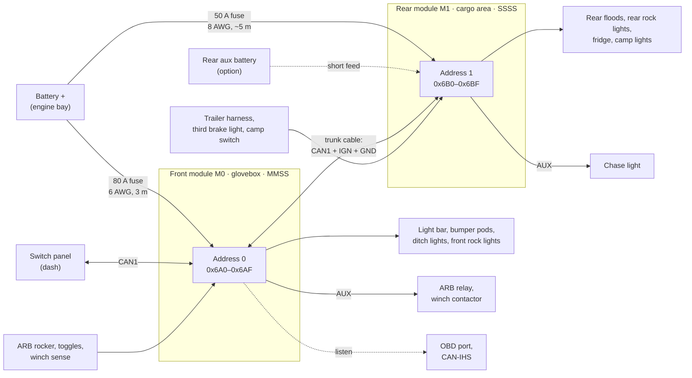

# 13 — Two-module JK system (glovebox + rear)

The architecture has always allowed up to four modules on one accessory bus
(FN-11). The JK build uses two: a **front module in the glovebox** and a
**rear module in the cargo area**. Same boards, same firmware; each module
has its own power-board variant, address and configuration file. Loads are
switched near where they are, which shortens the high-current runs and puts
the trailer-harness signals next to the module that uses them.

## Layout

## Who does what

| | Front module (M0) | Rear module (M1) |
|---|---|---|
| Location | Glovebox (passenger side, cab) | Cargo area, behind a quarter trim panel or on a side wall, above the floor |
| Address / IDs | 0 → `0x6A0–0x6AF` | 1 → `0x6B0–0x6BF` |
| Variant | `MMSS` | `SSSS` |
| OUT1 | Light bar (M) | Rear floods (S) |
| OUT2 | Bumper pods (M) | Rear rock lights (S, PWM) |
| OUT3 | Ditch lights (S) | Fridge (S, low-voltage cut-off) |
| OUT4 | Front rock lights (S, PWM) | Camp lights (S, PWM) |
| AUX | ARB relay, winch contactor, rocker indicator, spare | Chase light, spares (ARB relay here instead if the compressor is mounted in the cargo area) |
| Inputs | ARB rocker, ditch/bar/pods toggles, winch sense ×2, spare | Trailer reverse, third brake light, trailer stop/turn ×2, tail lamps, camp switch |
| Vehicle CAN | OBD port + CAN-IHS taps (short stubs from the glovebox) | None — reads them through M0 |
| Power | 6 AWG, 80 A fuse at the battery | Own feed: 8 AWG, 50 A fuse at the battery — or a rear auxiliary battery |
| Configuration | [`config/jk-front.yaml`](../config/jk-front.yaml) | [`config/jk-rear.yaml`](../config/jk-rear.yaml) |

## Power

| Rear feed option | For | Against |
|---|---|---|
| **Own fused feed from the starting battery** (default): 8 AWG, 50 A fuse or manual-reset breaker at the battery, ~5 m on a 4-door (~4 m on a 2-door) | Simple; no extra battery | 0.41 V drop at the full 40 A (3.1 %), 0.22 V at the expected 21 A; 6 AWG brings 40 A down to 0.26 V. Fridge and camp loads discharge the starting battery (the shed threshold protects it). |
| **Rear auxiliary battery** charged by a DC-DC charger | Short feed; fridge and camp loads never touch the starting battery | Second battery, charger and its wiring; shed thresholds must suit the aux battery's chemistry |
| Feeding M1 from an M0 output | — | Not recommended: limited to that output's rating, stacks two voltage drops, and M1 loses its own supply (and cannot wake) whenever the output is off |

- **Battery voltage estimate.** Under load the rear module reads its supply
  lower than the battery by `I × R_feed`. With `feed_resistance_mohm`
  configured (10.3 mΩ for 5 m of 8 AWG), firmware derives `VBAT_EST` and uses
  it for load shed, so the fridge cut-off acts on battery voltage rather than
  on cable drop.
- **Grounds.** M1 grounds to a body point at the rear (12 AWG). The trunk
  cable carries a signal ground so the two modules' CAN references stay
  close; the transceivers tolerate several volts of common-mode offset
  anyway.

Drops from `python3 tools/budget.py` (20 °C copper):

| Module | Run | Current (A) | AWG | One-way (m) | Drop (V) | Drop at 13.5 V (%) |
|---|---|---:|---:|---:|---:|---:|
| Front | Battery feed to the glovebox module | 60 | 6 | 3.0 | 0.23 | 1.7 |
| Rear | Battery feed to the rear module, 8 AWG, at rating | 40 | 8 | 5.0 | 0.41 | 3.1 |
| Rear | Same 8 AWG feed at the expected 21 A | 21 | 8 | 5.0 | 0.22 | 1.6 |
| Rear | Battery feed to the rear module, 6 AWG, at rating | 40 | 6 | 5.0 | 0.26 | 1.9 |

The output runs for both modules are in [08](08-mechanical-and-wiring.md#harness).

## Accessory bus and trunk cable

- **Trunk cable, front to rear:** CAN1-H/L as a twisted pair, `IGN` (18 AWG,
  from the same TIPM tap) and a signal ground (18 AWG), with an inline DT
  4-way at each end for service. Route it along the factory harness path
  under the sill trim, away from seat-belt and SRS wiring; the 8 AWG feed runs
  in its own loom.
- **Topology:** panel (dash) — M0 — M1, about 5–6 m in total, far inside
  CAN's limits at 500 kbit/s. Terminate the two physical ends: the panel and
  M1. Until the panel exists, terminate M0 and M1. With everything
  unpowered, CAN-H to CAN-L must measure ~60 Ω.
- **IDs and load:** module 1 uses `0x6B0–0x6BF`. Both modules plus the
  panel's commands put 166 periodic frames/s on the bus, ≈ 4.5 % of
  500 kbit/s. [`can/pcm-jk.dbc`](../can/pcm-jk.dbc) covers both modules; it is
  generated from `can/pcm.dbc` by `python3 tools/gen_dbc.py --modules 2 --out can/pcm-jk.dbc`.
- **Panel:** a host to each module — it sends a `Command` frame to each
  address and maps each button to a (module, `VIN`) pair.

## Peer signals

There is no master. Every module already broadcasts its `Status`,
`Currents`, `Aux`, `Inputs` and `VehicleA/B` frames; a module lists its peers
in configuration and reads theirs. Rules then use a peer's values as
`M<address>.<source>` ([07](07-firmware.md#rule-engine)):

| Rule on the rear module | Uses |
|---|---|
| Rear floods off above 15 km/h | `M0.VS2` — vehicle speed decoded by the front module |
| Rear rock lights follow the front rock lights | `M0.OUT4` |
| ENGINE_RUNNING for a compressor relay on the rear module | `M0.VS1` (RPM) and the rocker `M0.IN1` |

A peer value goes stale after three of its sender's periods; stale reads
false, like a stale vehicle signal. So:

| Failure | Front module | Rear module |
|---|---|---|
| Front module dead or unpowered | — | Local rules keep running (reverse floods from the trailer wire, fridge, camp lights, chase light); rules needing M0 values fall back safe (no speed interlock means the floods still need reverse to come on) |
| Rear module dead | Unaffected | — |
| Trunk cable cut | Runs its local rules | Runs its local rules; M0 values stale |
| Panel dead | `on_host_loss` per output | `on_host_loss` per output |

## Sleep and wake with two modules

A transceiver in standby wakes on *any* bus traffic, so a module kept awake
overnight (the rear module running the fridge) would keep waking the other.
Rules (FN-18):

1. **Parked** = IGN off and no host `Command` for 30 s.
2. A parked module with any output on sends `Status` every 10 s; with all
   outputs off it sends nothing and goes to sleep.
3. Every state change is sent as a burst of three `Status` frames 50 ms
   apart, so a peer woken by the first frame receives the next two.
4. A module woken by bus activity listens for up to 100 ms and stays awake
   only if a `Command` addresses it or a peer frame changes the result of one
   of its rules; otherwise it goes straight back to sleep.
5. Peer values time out at three of the sender's periods: 300 ms normally,
   30 s from a parked sender (the receiver knows from the sender's last
   `IGN_Active`).

Estimated cost: with the fridge running on M1 all night, M0 wakes six times
a minute for ≤ 100 ms, ≈ 0.15 mA averaged. Selective-wake transceivers
(TI TCAN1145-Q1, NXP TJA1145A — ISO 11898-2:2016 partial networking) would
remove those wake-ups by waking only on configured frames; they are an option
for a later revision. With everything parked, the system draws about
2 × 193 µA + the panel's ≤ 100 µA ≈ 0.5 mA.

## Thermal

From `python3 tools/budget.py` — hottest junction / enclosure base (°C),
bold = over a limit. The closed glovebox is modelled as a second box around
the module (assumed +4 K/W).

| Case | Build | Loads (A) | Aluminium box | Printed shell + Al plate | Printed shell only |
|---|---|---|---:|---:|---:|
| Front, closed glovebox | MMSS | rated | 125 / 100 | 132 / 107 | **154** / **129** |
| Front, closed glovebox | MMSS | 20, 12, 6, 3 | 110 / 85 | 114 / 89 | 127 / 102 |
| Front, vented glovebox or plate on dash metal | MMSS | 20, 12, 6, 3 | 96 / 71 | 99 / 74 | 112 / 87 |
| Rear, cargo area | SSSS | rated | 84 / 71 | 88 / 75 | 102 / 89 |
| Rear, cargo area | SSSS | 8, 4, 5, 4 | 76 / 67 | 77 / 69 | 83 / 74 |

- **Front:** fine in a closed glovebox at the expected loads (114 °C
  junction, 89 °C base — under ASA's 100 °C). With every slot at its rating
  the base reaches 107 °C, past ASA, so for full-rating use vent the bin's
  back wall into the dash cavity, bolt the plate through the bin to a metal
  dash member (the "plate on dash metal" row), or print the shell in PC or
  PET-CF.
- **Rear:** runs cool. Even printed-only stays under every limit (89 °C base
  at full rating), so the aluminium plate is optional there; it is still the
  simplest mounting.

## Installation notes

**Glovebox (front):**

- Fit-check the 160 × 120 × 50 mm envelope with a PLA print first; the
  module takes a good part of the bin.
- The harness leaves through a grommet in the back wall of the bin.
- The passenger airbag sits in the dash above the glovebox: keep the
  module, brackets and harness out of the airbag module's space and
  deployment path, and away from the yellow SRS wiring.
- Upside: the USB service port and status LED are reachable by opening the
  glovebox. The OBD port and the radio/cluster CAN-IHS taps are short runs
  away.

**Rear:**

- Above the floor, away from the tailgate seal and the window drain path;
  close to the trailer harness, the tailgate harness and the fridge.
- **Brake signal:** the trailer harness carries combined stop/turn, which
  needs ~0.7 s to tell braking from a turn signal. The third brake light on
  the spare-tire carrier has its own two-wire harness (reached behind the
  tailgate trim); confirm with a meter that it is live only with the pedal
  pressed, and use it for an instant brake input (chase light).
- The fridge's own low-voltage cut-off sees the voltage at its terminals: a
  short, heavy fridge run (12 AWG, 1.5 m: 0.08 V at 5 A) keeps it from
  cutting out before the module's shed threshold.

## Open questions for this layout

Q-15 compressor location (under the hood → front module AUX; cargo area →
rear module AUX), Q-16 rear auxiliary battery, Q-17 two-door or four-door
(rear feed length) — see [10](10-decisions-and-open-questions.md#open-questions).
